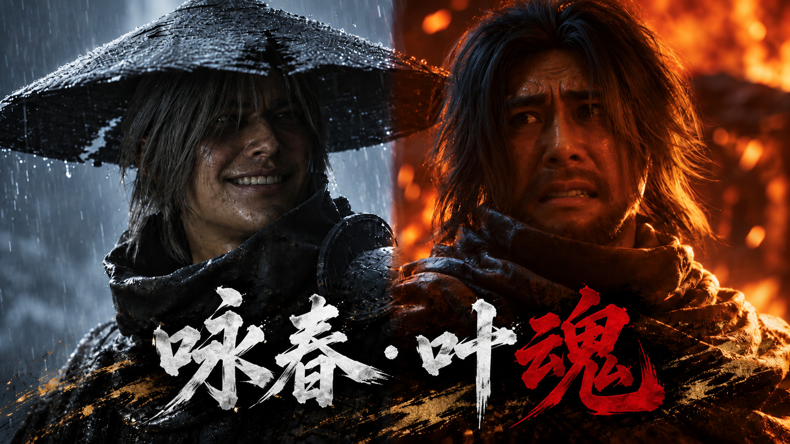

<div align="center">



# Cringe Blade Zero · 豪之刃

**In-Game Feature Toolbox for *Phantom Blade Zero* (《影之刃零》)**

A comprehensive `version.dll` proxy mod featuring a custom-rendered ink-and-gold in-game Hub, Boss Rush mode, 53 native humanoid Boss grabs, aerial combat & Jump Cancel (JC) system, dual weapon presets, 0–10 tier gear scaling, and full gameplay support for 75 playable NPC / humanoid Boss appearances.

[English](README_EN.md) · [简体中文](README.md)


**[⬇ Download Latest Release (CringeBladeZero.zip)](https://github.com/Jersyi/cringe-blade-zero/releases/latest/download/CringeBladeZero.zip)** · [All Releases](https://github.com/Jersyi/cringe-blade-zero/releases) · [❤ Donate](#donate--support-the-author)

This mod is 100% free and open-source. All features are fully unlocked without donation. If you enjoy the project, you can voluntarily support the developer on [Afdian](https://afdian.com/a/Jersyi1).

</div>

---

## Table of Contents

- [Features Overview](#features-overview)
- [Default Hotkeys](#default-hotkeys)
- [Body & Skeleton Customization](#body--skeleton-customization)
- [Local Dummy Sandbox](#local-dummy-sandbox-experimental)
- [Installation & Updates](#installation--updates)
- [Environment Check & Diagnostics](#environment-check--diagnostics)
- [Configuration File (INI)](#configuration-file-ini)
- [Building & Testing](#building--testing)
- [Project Architecture](#project-architecture)
- [Developer Documentation](#developer-documentation)
- [Donate](#donate--support-the-author)
- [License & Disclaimer](#license--disclaimer)

---

## Features Overview

> [!TIP]
> For in-depth explanations and complete node references, read the **[User Manual (Markdown)](docs/USER_MANUAL.md)** or download the **[Chinese PDF Manual (60 pages)](https://github.com/Jersyi/cringe-blade-zero/releases/latest/download/CringeBladeZero_Manual_ZH.pdf)**. The manual contains 36 node diagrams, 9 UI renders, and exhaustive breakdowns of all 32 node types.

| Feature Module | Key Highlights | Details |
|---|---|---|
| **In-Game Hub** | Custom-drawn UI<br>Full English & Chinese | • Borderless custom rendering designed to match the game's ink-and-gold art style<br>• Press **F10** to toggle at any time; optional setting to pause the game while open<br>• Full gamepad navigation and instant Chinese / English language switching |
| **Hotkeys System** | Keyboard / Xbox / PS<br>Smart Input Detection | • Detects the active input device and dynamically updates on-screen button prompts<br>• Controller shortcuts require pressing two buttons within 220 ms to avoid game conflicts<br>• Easily rebind directly within the Hub; all keys persist to INI |
| **Boss Rush** | Instant Teleport & Fight<br>Custom NG+ Difficulty | • Teleport directly to any Boss arena and trigger encounters instantly<br>• Configure continuous Boss Rush gauntlets, sequence, and NG+ difficulty curves<br>• Built-in arena entry protection and save protection guards against softlocks |
| **Boss AI** | Live AI Tuning | • Inspect and adjust native AI decision trees and parameters on active Boss instances<br>• Dynamically modify aggression levels, attack cooldowns, and move weights |
| **Boss Grabs** | 53 Native Humanoid Grabs<br>Full Weapon & Animation Match | • Default hotkey: Keyboard `G` / Xbox `Y+B` / PS `△+○`; executable even during hit-stun or knockdown<br>• Replayed by an invisible Boss skeletal proxy, temporarily equipping the Boss's native weapon with authentic displacement and camera framing<br>• Replicates the native red warning flash at the head at move startup (can be toggled off)<br>• Configurable damage multiplier and ignore-invulnerability setting<br>• Optional "Transform to Boss during grab": morphs into the Boss for the grab execution, then reverts to the protagonist |
| **Air Skills / JC** | Mid-Air Combat Skills<br>Near-Enemy JC Bouncing | • Cast ground combat skills and ShaQi moves in mid-air; enables air dodges and dashes<br>• Cancel attack backswing with jumps; jump-cancel (JC) off nearby enemies to reset air light attack limits<br>• Grants airborne resource rewards and controllable slow-fall gliding |
| **Weapon Presets** | Instant Loadout Swap | • Swap between two complete equipment sets instantly (default: Keyboard `Z` / Xbox `LB+L3` / PS Touchpad swipe left/right)<br>• Displays native weapon icons and official in-game names; persists across game sessions |
| **Gear System** | 0–10 Capsule Tiers | • Capsule widget on the bottom-right (adjust with Keyboard `=` / `-`)<br>• Higher tiers unlock more enhancements (JC, Grabs, bonuses, damage multiplier, hyper armor break, invulnerability bypass)<br>• Tier 10 ignites an animated hand-drawn fire aura |
| **Playable NPCs** | 75 Playable Models<br>Dynamic Proportions | • Play as 75 NPC / humanoid Boss models while retaining the protagonist's full moveset and abilities<br>• Arm bones, weapon sockets, collision capsules, and camera distance scale to fit NPC proportions<br>• Cutscenes automatically apply the chosen appearance and smoothly revert afterwards |
| **NPC Skills** | Native Hitboxes & VFX<br>Time-Stop Mechanics | • Press the NPC skill key (Keyboard `X` / Pad `L3+R3`) to unleash the current Boss's native signature moves<br>• Seamlessly swaps to the Boss's weapon, copying attack hitboxes, weapon trails, and particle effects<br>• Faithful replication of exclusive Blueprint mechanics (dragon pillars, MoTian pillars, counter parry flash, lightning cavalry mount)<br>• Slow-motion / time-stop moves (e.g. MengHua Mother, Void) keep the player at normal speed while slowing down surrounding enemies within 100m (grab victims remain synchronized with the player)<br>• Damage multiplier adjustable from 1x to 10x (default 3x) |
| **Move Combos** | 32 Visual Graph Nodes<br>Precision Timeline Control | • Visual derivation graph: Boss skills/VFX, weapon derivations, grabs, assists, branching, combo containers, speed curves, action clipping/holding, air derivations, and bone transformations<br>• Dual-tab layout (Nodes / Weapons) with real-time search, move preview cards, multi-file management, and bundled sample combos (`sampleCombo.combo`)<br>• Precision timeline: node arrival starts independent interval timers; clean implicit loop execution |
| **Combo Plugins** | DLL & Lua 5.4 Scripting<br>Module Bus & Permissions | • Dynamically load plugins from the `PBZPlugins` directory to add custom conditional branches (HP, distance, airborne, RNG) and signal keys<br>• Revision 2+ API grants read/write access to the entire mod (module attributes, actions, events, and custom Hub pages) subject to player authorization<br>• Built-in Lua 5.4.7 engine: edit `PBZPlugins\scripts\*.lua` and hot-reload in-game without restarting<br>• See [Plugin API Manual](docs/PLUGIN_API.md) and [Plugin Developer Guide](docs/AGENT_PLUGIN_GUIDE.md) |
| **Hair & Groom** | Real Hair & Cards Toggle | • Toggle between native hair representations, forced Groom mode, and real-time GPU bounding box debugging<br>• Automatically falls back to hair cards if a matching Groom asset is absent, without altering the protagonist's setup |
| **Debug Supplement** | 169 Native Debug Blueprints<br>*(Requires Supplement Pak)* | • Organizes 169 developer commands into 9 categorized card decks (God mode, flying, teleport, speed, DLSS, audio, items, talents, cutscene control, profiling)<br>• Search and filter support; critical save-modifying entries require a 3-second double-click confirmation |
| **System Features** | Deep Hardware Integration | • Option to disable DualSense adaptive trigger motor resistance<br>• Centralized settings management in `PBZDebugMenu.ini` |

---

## Default Hotkeys

### Core Bindings

| Action | Keyboard | Xbox Controller | PlayStation Controller |
|---|---|---|---|
| **Trigger Grab** | `G` | `Y` + `B` | `△` + `○` |
| **Cast NPC Skill** | `X` | `L3` + `R3` | `L3` + `R3` |
| **Swap Weapon Preset** | `Z` | `LB` + `L3` | Touchpad Swipe Left / Right |
| **Increase / Decrease Gear** | `=` / `-` | — | — |
| **Toggle Hub Panel** | `F10` | `View` + `Menu` | `Create` + `Options` |
| **Back / Hide · Switch Tab** | `Esc` · `Ctrl` + `Tab` | `B` · `LB` / `RB` | `○` · `L1` / `R1` |
| **Hair Page · Mesh / Groom** | `F7` · `F8` | — | — |
| **Force Groom · Outfit Unlock** | `F6` · `Shift` + `F6` | — | — |
| **GPU Bounding Box · Triggers** | `F9` · `Shift` + `F9` | — | — |

> [!NOTE]
> - **Dual-Button Gamepad Chords**: Controller shortcuts must be pressed within 220 milliseconds to prevent accidental triggers during combat.
> - **Input Auto-Detection**: Glyphs automatically adapt to the last used device (Steam Input / DS4Windows mapped DualSense controllers are recognized as PlayStation layout).
> - **Full Controller Navigation in Hub**:
>   - **D-Pad / Left Stick**: Move focus between controls and navigation sidebar; adjust sliders and dropdowns horizontally.
>   - **A / ×**: Confirm, toggle checkboxes, start hotkey recording.
>   - **B / ○**: Close dropdowns, step back to navigation sidebar, hide Hub.
>   - **LB / RB (L1 / R1)**: Switch pages; **LT / RT (L2 / R2)**: Scroll pages vertically.
>   - When the Hub is open, controller input to the game is blocked to prevent accidental player movement.

---

## Body & Skeleton Customization

The mod provides two distinct approaches to skeletal manipulation and body customization:

### 1. UUEPBS Body Editor
- Press **F11** to open the standalone [UUEPBS](https://github.com/XTGMods/UUEPBS) editor window (disabled by default).
- Adjust sliders per body part, configure per-bone transforms, save presets, and test animation stances (stand / walk / run / sprint).
- Features a custom searchable bone list (filtering out facial bones) and real-time full-body skeleton visualization.
- Affects the protagonist only and pauses while transformed into a Boss; presets are stored in `UUEPBS Presets/`.

### 2. Move Combo Bone Transform Nodes
- Each node can offset, rotate, and scale up to 32 bones simultaneously, sharing connection and timing rules with speed nodes.
- The node editor provides sections for body scale, bone details, and skeletal inspection with live hover previews.
- Shares the same underlying bone injection pipeline as UUEPBS to maintain state consistency.

### 3. Female Presets & Soft Bones
- Female animation presets include pelvic rotation, subtle hip-following movement, thoracic counter-rotation, and inertial breast/hip dynamics.
- An optional [PBZSoftBones Pack](docs/SOFT_BONES.md) provides weighted breast and hip bones for all 75 models and the protagonist (including both stages of Mu XiaoKui). Disabled by default.
- Refer to the [Animation Presets Guide](docs/ANIMATION_PRESETS.md) for tuning details.

---

## Local Dummy Sandbox (Experimental)

Enter any stage, open the **Network Test** page in the Hub without joining a room, and click **Spawn Dummy** to launch a local mirror sandbox:

- **Pose & Visual Synchronization**: The dummy uses network-grade pose encoding to duplicate player components, visibility states, Niagara / Cascade particle effects (including meteor chain bindings and points), and active projectile trajectories.
- **Local Hit Detection**: Click **Local Combat Judge / Reset** to have the dummy face the protagonist. Both entities are assigned 1,000 independent test HP. Contact with weapon hitboxes deals up to 100 damage per strike until HP reaches zero. Click **End Combat Judge** to revert to a passive mirror.
- **Hair Fallback**: Dummies default to Groom hair and smoothly fall back to hair cards if assets are missing, leaving the protagonist's hair settings unaffected.
- **Scope**: Designed for offline inspection of weapon trajectories and mutual hit detection; does not modify native game health or save data.

---

## Installation & Updates

> Steam and WeGame editions share the exact same release package and `version.dll`.

### Option A: Automated Installation (Recommended)

1. Exit the game. Download the latest release **[CringeBladeZero.zip](https://github.com/Jersyi/cringe-blade-zero/releases/latest/download/CringeBladeZero.zip)** and extract it.
2. Double-click `Install.bat`:
   - Automatically detects the game directory via Windows Registry and verifies the executable version.
   - Press **1** to install the **Full Version** (includes the official sample combo `combos/sampleCombo.combo`).
   - Press **2** to install the **Lite Version** (only disables DualSense adaptive triggers).
   - Press **3** to **Uninstall** and restore backed-up DLLs.
   - Press **4** to run the **Environment Check & Repair Tool** (`EnvCheck.exe`).
3. SHA-256 checksums are verified upon copying; any existing third-party `version.dll` is backed up automatically.

### Option B: Manual Installation

Copy `version.dll` from the archive into the folder containing `PBZ.exe`:
- **Steam**: `<Game Directory>\platform\steam\version.dll`
- **WeGame**: `<Game Directory>\version.dll` (alongside `PBZ.exe`)

### Optional: Debug Supplement Pak

Place custom supplement pak files (`PBZDebugSupplement.pak`, `.utoc`, `.ucas`) into:
`<Game Directory>\ProjectPBZ\Content\Paks\~mods\`
Upon game launch, the Hub will automatically unlock the **Debug Supplement** page.

---

## Environment Check & Diagnostics

If the game crashes on startup, the F10 Hub does not appear, or settings fail to save, run Option **4** in `Install.bat` or launch `EnvCheck.exe` directly (you can also drag-and-drop `PBZ.exe` onto `EnvCheck.exe`):

### Diagnostic Scopes

| Scope | Verification Items |
|---|---|
| **System** | • Windows OS version and updates<br>• Visual C++ 2015–2022 x64 runtime status (warns if below 14.40; game dependency)<br>• Direct3D 12 support, XInput controller connectivity, and UI fonts<br>• Validates all DLL export forwarders to system `version.dll` |
| **Security & Load Blocks** | • KnownDLLs registry redirection conflicts<br>• Windows Exploit Protection settings (Force System Image, Code Integrity Guard)<br>• Image File Execution Options (IFEO debugger hijacks), Smart App Control, and Attack Surface Reduction (ASR)<br>• Audits recent 30-day Defender and third-party antivirus interception logs |
| **Game Installation** | • `PBZ.exe` version matching and SHA-256 checksum (Steam and WeGame editions)<br>• Deployed `version.dll` integrity and "Mark of the Web" zone identifier check<br>• Detects misplaced copies in invalid folders (e.g. root or `Binaries`)<br>• Directory write permissions, read-only flags, and INI health<br>• Checksums of all files under `combos\` |
| **Runtime Audit** | • Hooks running game processes to verify the exact DLL path loaded into memory |

### One-Click Repair Actions

Press **A** to apply all recommended fixes automatically (or **R** to re-scan):
- Strips the Windows "Mark of the Web" download lock from `version.dll`
- Disables and renames misplaced or obsolete DLL copies
- Downloads, verifies Microsoft digital signatures, and installs the latest VC++ runtimes
- Quarantines corrupted `.combo` files to `combos\broken\`
- Grants the current Windows user full write permissions to the game directory
- Invokes system file verification (`sfc /scannow`) when system corruptions are detected

---

## Configuration File (INI)

All preferences are stored in `PBZDebugMenu.ini` next to `version.dll`. The file is written only when settings are changed. On first launch, it is created with all features disabled by default.

| INI Section | Key & Description | Default Value |
|---|---|---|
| `[UI]` | `Language`: Hub interface language (`zh-CN` / `en-US`) | `zh-CN` |
| `[Hub]` | `PauseGame`: Pause gameplay while Hub is open (`1` = yes, `0` = no) | `0` |
| `[Hotkeys]` | Shortcut keys: `<Action>`, `<Action>.Xbox`, `<Action>.PS`<br>`PadGlyphs`: Controller glyph icons (`auto` / `xbox` / `ps`)<br>`ToggleHub`: Open Hub key (default `kb:F10`) | See Hotkeys table |
| `[Gear]` | `Level`: Active gear tier (`0`–`10`) | `0` |
| `[Grab]` | `Enable`: Enable grabs; `TargetBoss`: Allow grabbing humanoid Bosses<br>`IgnoreInvulnerable`: Bypass enemy invulnerability; `RedFlash`: Startup head red flash | `0` |
| `[GrabExtras]` | `HidePlayerWeapon`: Hide protagonist's weapon during grab animations<br>`TransformToBoss`: Morph into the Boss during grab execution | `0` |
| `[NpcSkill]` | `DamageMultiplier`: NPC skill damage scaling factor (`1`–`10`) | `3` |
| `[NpcRetarget]` | `BossLocomotion`: Play the Boss's native idle / walk / run animations when moving | `0` |
| `[NpcCombo]` | `File`: Active combo file name in `combos\` directory<br>`ViewTarget`: Camera tracking point (`0` = Pelvis, `1` = Neck, `2` = Head)<br>`ViewScale`: Framing method (`0` = By height, `1` = By body scale) | `default`<br>`0`<br>`0` |
| `[NpcBody]` | `Enabled`: UUEPBS body editor switch; `Hook`: Bone write pipeline hook | `0`<br>`1` |
| `[AirSkills]` | `EnableAirSkills`: Mid-air combat skills; `NearEnemyJC`: Near-enemy JC bouncing | `0` |
| `[WeaponPresets]` | `PresetA`, `PresetB`: Equipment loadout slots; `ActivePreset`: Selected slot index | — |

---

## Building & Testing

### Prerequisites
- **Operating System**: Windows 10 / 11 x64
- **IDE & Compiler**: Visual Studio 2022 with **Desktop development with C++** and **MSVC v143 - VS 2022 C++ x64/x86 build tools** (including MASM)
- **CMake**: ≥ 3.24

### Build Commands

```powershell
# 1. Build all targets in Release configuration
.\build.ps1

# 2. Build and generate distribution package (dist\CringeBladeZero_*.zip)
.\build.ps1 -Package

# 3. Manual build via CMake
cmake -S . -B build -G "Visual Studio 17 2022" -A x64
cmake --build build --config Release --target version
```

### Build Outputs

| Target | Output Path | Description |
|---|---|---|
| `version` | `build/Release/version.dll` | Full feature mod dynamic library |
| `version_triggers` | `build/triggers_only/version.dll` | Lite mod DLL (disables adaptive triggers only) |
| `EnvCheck` | `build/Release/EnvCheck.exe` | Standalone diagnostic and environment repair tool |
| `env_check_test` | `build/Release/env_check_test.exe` | Verification test for PE import/export and diagnostic logic |

### Automated Test Suite

Offline and simulated test binaries are compiled with `/W4 /WX /utf-8` using static CRT:

| Category | Test Binaries | Validation Scope |
|---|---|---|
| **Core & Lifecycle** | `proxy_test`<br>`game_thread_test` | DLL export forwarding, game main thread hook scheduling, UObject reflection, and command bus safety |
| **Input & Gamepad Gate** | `pad_triggers_test`<br>`pad_gate_test`<br>`game_pad_gate_test`<br>`input_focus_test` | DualSense packet interception; simulated window thread focus capture and pad message blocking; hotkey recording, migration, and seamless device switching |
| **Appearance & Poses** | `npc_pose_transfer_test`<br>`hair_controls_test` | Synthetic skeleton pose retargeting, two-handed weapon scaling, mount proxy; Groom binding and hair card fallback |
| **Combo Graph & Saves** | `npc_combo_test`<br>`combo_file_test`<br>`combo_save_stress_test`<br>`combo_library_test` | 32 node types, branch resolution, pause timing, hyper armor/invulnerability scoping; `.combo` format compression, concurrent safety, and corrupted file isolation |
| **UI Rendering & Preview** | `combo_menu_preview` | Headless rendering of the combo editor; automated scripts verify node dragging, wire connections, hotkey recording, curve editing, and move preview cards |

---

## Project Architecture

```text
src/
├─ core/          DLL proxy entry (proxy.cpp, forwarders.asm), worker threads, reflection, and command bus
├─ ui/            Custom ink-and-gold Hub, theme engine, bilingual localization, input focus, gear widget, Donate page
├─ character/     Appearance retargeting (pose transfer, weapon fit, collision scaling, mounts), combo engine, body editor
├─ plugin/        Combo plugin host, Lua 5.4.7 scripting VM, global module registry (mod_registry), and permission bus
├─ boss/          Boss Rush flow, live Boss AI tuning, Boss assists, dummy spawner, move previews, safety guards
├─ grab/          Native Boss grabs: paired ability activation, state lease, independent weapons & proxies, damage scaling
├─ air/           Air combat skills, air dodge, near-enemy JC bouncing, and fluid gliding mechanics
├─ weapons/       Instant dual-weapon preset swapping, game weapon icons and name mappings
├─ net/           Local dummy sandbox: pose frame encoding, Niagara particle sync, projectile mirroring, and local hit detection
├─ pad/           DualSense adaptive trigger damping bypass, input shielding gateway when Hub is active
├─ hair/          Hair rendering modes, forced Groom state machine, GPU bounding box debug
├─ supplement/    Native debug blueprint integration: 169 developer commands restructured into cards with safety guards
├─ uuepbs/        UUEPBS body & skeletal editor (third-party integration)
├─ third_party/   Dear ImGui, Lua 5.4.7, stb_image
├─ generated/     Static data tables reverse-engineered from game data (NPCs, weapons, bone maps, icons)
├─ env_check/     Source code for EnvCheck.exe diagnostic and repair utility
└─ triggers_only/ Lite version version.dll build target

sdk/              Plugin development SDK (pbz_combo_api.h, C++ sample plugins, Lua samples)
tests/            Unit test suites and offline GUI rendering test harnesses
installer/        One-click installation scripts and assets (Install.bat / install.ps1)
samples/          Official sample combo file (sampleCombo.combo) and UUEPBS sample presets
licenses/         Full text of open-source licenses for third-party libraries
docs/             Architecture, compilation, reverse-engineering update guides, and documentation
scripts/          Executable hashing tools, empty pak generator, PDF manual builder
```

---

## Developer Documentation

- **[AGENTS.md](AGENTS.md)**: Coding standards, immutable rules, and task-oriented documentation index
- **[Architecture Guide](docs/ARCHITECTURE.md)**: Threading model, UObject reflection, four-layer combo architecture, and plugin system
- **[Build & Packaging](docs/BUILD.md)**: Build dependency toolchain, offline testing, and release packaging details
- **[Game Update Guide](docs/GAME_UPDATES.md)**: Address recalculation, pattern signature matching, and data table generation for game updates
- **[Custom Pak Workflow](docs/PAK_WORKFLOW.md)**: UnrealPak compression, mod mounting rules, and AES encryption keys
- **[Plugin API Manual](docs/PLUGIN_API.md)**: C/C++ API specification, event bus, global module access, and Lua interfaces
- **[Plugin Developer Guide](docs/AGENT_PLUGIN_GUIDE.md)**: Plugin starter templates, hot-reload workflows, and troubleshooting
- **[Animation Presets Guide](docs/ANIMATION_PRESETS.md)**: Parametric calculations, full-body pose tuning, and soft bone dynamics
- **[Weapon Derivations Guide](docs/WEAPON_DERIVATIONS.md)**: Hold inputs, parry combinations, and weapon move customization

---

## Donate · Support the Author


**Cringe Blade Zero is completely free.** All features are fully accessible without any payment or donation gates.

If you enjoy this mod and would like to support ongoing updates, voluntary sponsorships are warmly welcomed:

- **Afdian Page**: **<https://afdian.com/a/Jersyi1>**
- Or scan the QR code on the right with a mobile device.
- You can also open the Hub (**F10**) in-game and navigate to the **Donate** page to access the QR code and link.

<br clear="right">

---

## License & Disclaimer

### Open Source License

Original code and documentation in this repository are released under the **[MIT License](LICENSE)**, Copyright (c) 2026 Jersyi.

The following third-party components are excluded from the MIT license and retain their respective terms:
- Dear ImGui and Lua 5.4.7 in `src/third_party/`; stb_image in `src/uuepbs/third_party/`: see `licenses/` and [Third-Party Notices](THIRD_PARTY_NOTICES.md).
- UUEPBS Body Editor source code and sample presets: based on designs by XTGMods, see [Third-Party Notices](THIRD_PARTY_NOTICES.md).
- Icons, fonts, and data tables in `src/generated/` are extracted from game assets; all rights belong to the original copyright owners.

### Disclaimer

- This mod is developed exclusively for offline, single-player gaming and technical study. It is not affiliated with or endorsed by the game developers.
- Please do not use this tool for commercial profit or in any online multiplayer context.
