# 豪之刃 · 功能与节点手册

适用版本：2026-11-10。Steam / WeGame 共用完整版 DLL。本文以本仓库功能、节点规则和界面为准；联机为测试功能，部分外观与特效仍需实机确认。

## 从安装到第一条连招

### 安装与打开

退出游戏，完整解压安装包，运行 Install.bat。选择 1 安装完整版；选择 2 只安装关闭 DualSense 自适应扳机的精简版，没有面板。两版同名，只装其中一种。安装器自动发现游戏，也可输入 PBZ.exe 所在目录。

Steam 的 DLL 位于游戏目录的 platform/steam；WeGame 位于 PBZ.exe 旁。进入场景后按 F10 打开面板。未知游戏版本会限制功能，先运行 EnvCheck.exe 或安装器菜单 4 检查。

### 载入作者示例

完整版会安装 combos/sampleCombo.combo；菜单 5 可单独安装。进入「招式派生」，在文件列表选择 sampleCombo，再选择「主角」派生表。安装不会自动切换当前文件，也不覆盖 default。

已有改过的 sampleCombo 时，安装器保留它，将随包示例另存为 sampleCombo_bundled_校验码.combo；继续冲突会追加编号。以安装器显示的实际名称为准。

### 首次使用顺序

第一次启动时所有功能默认关闭，包括打开面板时暂停游戏、关闭自适应扳机和派生提示，需要哪个就在面板里打开；设置随后保存在 PBZDebugMenu.ini。

先选择当前角色的派生表，确认起端已启用且接有招式；召唤测试木桩，关闭面板后按起端指定的键。熟悉示例后先「另存为」自己的名称，再编辑。

## 面板、输入与文件

### 面板交互

左侧切换功能页；可在设置中调整语言、打开面板时暂停游戏。预览技能时由独立预览场景实时渲染，主角与敌人按预览流程冻结，退出预览后恢复面板暂停状态。状态栏说明实际执行结果。

| 操作 | 键盘 | Xbox | PlayStation |
|---|---|---|---|
| 面板开关 | F10 | View + Menu | Create + Options |
| 投技 | G | Y + B | 三角 + 圈 |
| NPC 技能 | X | L3 + R3 | L3 + R3 |
| 武器预设切换 | Z | LB + L3 | 触控板左右滑 |
| 挡位升 / 降 | = / - | 以快捷键页为准 | 以快捷键页为准 |

快捷键页可分别配置键盘、Xbox、PlayStation。面板用十字键或左摇杆导航，A/叉确认，B/圈返回，肩键切页，扳机滚动。面板打开时屏蔽传给游戏的手柄按键。

### 保存范围

PBZDebugMenu.ini 保存面板与功能设置；combos 下的 .combo 保存各外观派生表。派生文件是带校验的压缩二进制，不能直接当文本编辑。文件列表选择当前文件；保存、另存为、自动重载用于维护不同方案。另存到 combos 外只导出副本。

卸载 DLL 后设置和连招保留。安装其他版本前备份自己的 combos 与 INI；不要把示例当成不可恢复的默认配置。

## 功能总览：战斗与角色

### Boss 连战与 Boss AI

Boss 连战支持搜索、地图筛选、只看可传送项、传送到选定 Boss、直接触战、从当前条目开始连战、下一位、重试，以及停止并返回。可调整挑战周目与游戏难度，选择击败后自动下一位、连战时恢复状态。未确认入口的条目不会提供虚假的可用传送。

Boss AI 页面读取当前真实 Boss 实例：攻击/反应概率、反应权重、行为冷却和剩余冷却等。按真实 Key 筛选，选参数查看类型、单位、来源和范围，输入后应用，再刷新确认。恢复修改只还原本次跟踪的实例值；换 Boss 后重新读取。

### 角色替换与 NPC 重定向

角色替换用于主角兼容装束，可查看内部资源，应用临时模型或恢复原模型。NPC 重定向用于 75 个原 NPC / 人形 Boss 外观，提供搜索、检查模型、应用与恢复。保留主角 Actor、输入与能力，适配身体、头部、头发、衣物、武器挂点和相关碰撞。

过场时尝试将外观应用到原生过场主角，结束后返回主角控制。特殊骨架、服装和过场依赖实际资源与场景，不意味着每条过场均已验证。

### NPC 技能与武器演出

NPC 技能快捷键使用当前外观的招式；可用派生链组织固定顺序。NPC 页调整技能伤害倍率。BOSS 招式会借用对应武器、攻击碰撞和已支持的特效；跨外观动作保留当前角色骨骼比例。隐藏预装配池减少重复创建身体和附件的开销，首次冷加载仍可能停顿。

## 功能总览：投技、空中与装备

### 投技

投技页提供原生人形 Boss 投技目录、释放开关、伤害与无视无敌等配置，并可选择投技时变为所属 Boss。按投技快捷键对可投目标执行。武器按原生演出显示或隐藏；成对动作需要正确目标和当前状态。

节点投技可独立选择招式，不要求投技页选择同一招。没有有效目标时节点可能跳过；配对动作中的伤害由原生时间轴决定，有些伤害集中在收尾。

### 空中技能 / JC

空中释放和近敌 JC 是独立开关。支持空中战技/影之武装、跳跃优先打断、空中闪避，并保留原生空中轻重攻击。近敌 JC 在实际弹起且旧攻击完成清理后重置空中普攻限制；此重置独立于资源奖励。

可选 JC 资源恢复与本次腾空下降减速。弹跳速度可设 100-3000 cm/s，近敌范围 10-1500 cm；应用后查看状态与限制读回。菜单、死亡和剧情状态不触发。关闭功能可恢复原限制。

### 武器预设与挡位

武器预设保存两套装备，通过快捷键切换，显示原生武器图标与名称。与派生链中「临时拿某武器放一招」不同，它用于装备方案切换。

右下角挡位为 0-10 档，逐步关联 JC、投技、资源奖励、伤害倍数和无视无敌等功能。调整挡位后核对各功能页状态，避免同时把挡位变化与节点倍率当成单一因素。

## 功能总览：骨骼与毛发

### 骨骼编辑

独立骨骼页与节点详情共用自绘界面：左侧身体分组与搜索，中部骨骼列表，右侧变换/动态、预设、状态。列表排除表情骨骼；可只看已调整项，显示全身骨架调试。

位移、旋转、XYZ 缩放都有滑条，可开启数值输入精调。整体大小联动三轴；全身 root 分组用于整体体型。拖动预览，松手保存；可启停整组或单行、重置单行和清空本组。每组最多 32 行，同一骨骼可以有不同动态行。

子骨骼模式包括继承变换和缩放、跟随形状但保持尺寸、只改当前骨骼并保留后代姿势。镜像按参考骨架轴换算；不支持的非均匀缩放剪切会拒绝，不会悄悄近似。

### 女性预设与 Jiggle

预设在原动作上添加胯部转动、躯干反向转动及胸臀惯性，不是一套新动画，也未使用 ONNX。惯性跟随才是 Jiggle；静态或随原动画转动不会产生同样的弹性。调整强度、位移上限、频率、阻尼，并通过走跑和战斗观察。

缺失胸臀骨骼时可启用可选补充，实际匹配不到的骨骼会显示并跳过。原有运动学碰撞体跟随最终骨骼变换；新增胸臀使用独立近似盒体，不自动替换独立布料碰撞。保留腿部原姿势可减轻脚部漂移，但不是完整地形 IK。

### 毛发 / Groom

支持毛发表示切换、强制 Groom、套装相关强制显示、恢复及 GPU 包围盒调试；没有资源或没有活动毛发时可能不显示包围盒。DualSense 扳机也可切回游戏控制。替身头发另有独立设置，默认 Groom，缺资源时回退发片。

## 功能总览：联机测试与辅助工具

### 联机测试

Steam 房间支持建立、邀请、加入房间、离开和连通检查。两机需要两个拥有游戏的 Steam 账号；同一账号不能连接自己。普通替身同步姿势、部件可见性及已支持的特效，完整战斗同步仍在验证。

本地无需进房间：生成替身并开启离线模仿，正常出招即可查看显示。可切换 Groom/发片，移除替身，查看来源、特效数量和状态。子弹/投射物表现与不同技能需要逐项验证，不能据替身有动作就断言所有技能都可远程造成伤害。

### 本地对战判定

实验对战使用独立实验血量，按武器轨迹接触和攻击动画名称识别窗口；每次攻击最多扣一次实验血量，可以重置。当前不包含完整原生受击、格挡或投射物判定。普通替身不会对游戏对象施加真实 PVP 伤害，本功能不等于可发布的完整联网 PVP。

### 测试木桩、技能提示与 Donate

派生页可召唤不移动、不攻击、锁血的测试木桩，再点移除；适合检验输入、动画、武器和特效。派生提示开关控制链内招式名提示，NPC 独立技能键提示另行处理。

「派生显示」在关、详细、简略之间切换。详细在游戏右上角显示整条派生链的缩略图，正在放的招式高亮，已记住的下一键对应的招式加虚线框；简略显示当前招式和此刻所有有用的按键：先是接下来能接的键，再是「其他起手」（其他链的起手键），待命时是全部起手键，类似怪物猎人荒野的连段提示；详细模式在缩略图下方列出同样的按键。同一个键有几行分支时（点按和「按住」、立刻按和「停顿」后再按），此刻按下会走的那一行加框、它的「按住」「停顿」标签变亮：停顿时间到了框会移到停顿那一行，按住够久会移到按住那一行。开启后常驻：没有派生链在进行时显示上次那条派生链停在起点（待命），只在调试界面盖住游戏或切出游戏时隐藏。

「镜头跟随」在骨盆、脖子、头部之间切换（默认骨盆），决定招式中视角跟随镜头盯着模型的哪个部位。骨架上没有对应骨骼时依次退到相近的部位（脖子和头部互为替补，最后退到骨盆）。切换后插件先交回游戏镜头，量好游戏镜头对新部位的相对位置，再重新接管。

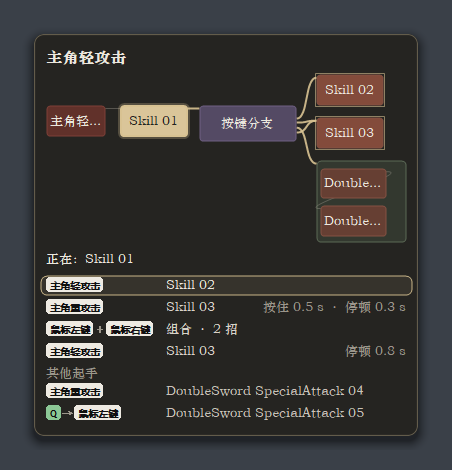

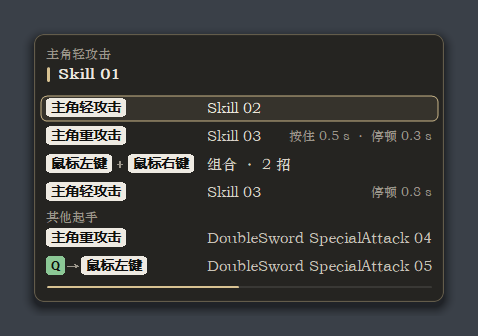

顶栏的「技能伤害」「投技伤害」只管派生链放出的 BOSS 技能和投技：选了数值就代替 NPC 技能页和投技页的设置，选「跟随」则仍按那两页。伤害倍率节点在此基础上再相乘。

Donate 页提供作者支持链接和二维码。MOD 免费，所有功能不以捐赠解锁。

### 环境检查

EnvCheck.exe 或安装器菜单 4 检查系统组件、运行库、图形支持、游戏版本、DLL 位置、其他加载器、写入权限、日志和派生文件。按实际检测结果选择修复。工具结果不等于所有技能和视觉效果已通过实机验证。

## 编辑器：连线、预览与复制

### 三种关系

执行线决定招式先后：从起端或动作的执行输出连接后续动作/流程。分支和武器派生修改各行有独立出口。修饰箭头从要被影响的节点指向修饰节点；不要把加速、骨骼或无敌串在执行链中。组合框的包含关系将多个动作组织为一次输入的一段。

@flow 按键 / 替换按键 > BOSS 技能 A > BOSS 技能 B

例如给 A 加速：保留上面的执行线，再从 A 的修饰圆点指向加速节点。给整条链加速则由起端指向加速。同类修饰通常按当前动作、所在组合、起端确定作用范围；局部参数优先，不应假设连多个加速会相乘。

### 查找与编辑

右侧只有节点列表、武器列表两页，分类位于节点页内部，底部翻页或在栏内滚轮翻页。Tab/右键搜索添加，拖动节点排列，从执行引脚拉到空白处可搜索并自动接线。搜索框可输入文字。

画布支持框选、移动、缩放、整理、显示全部、删除、复制和粘贴。Ctrl+C/V 只在画布焦点处理；输入框保留文字编辑。复制组合包含其子节点，内部关系保留，外部连线断开，新节点重新编号并偏移。固定唯一节点不重复复制。

### 技能预览

鼠标停留于支持的 BOSS 招式、投技、援护及相关节点后出现实时预览。预览适配加速、裁剪与骨骼参数；主角原生招式不都有预览。预览放开鼠标后收起；这是查看动作的工具，不替代实际施放伤害验证。

## 编辑器：时间与中断规则

### 按键与执行进度

普通链通常一次按键推进一招；组合可把多个动作装入一次输入。预输入只记一个待执行键，新输入可覆盖旧输入。是否能接下一招由本招的派生点、允许中断及实际结束共同决定。

派生点为 0 时等待动作结束；大于 0 时到相应阈值后允许派生。隐式“链尾接首招”仍需等待最后一个动作及其收尾，不因连按提前重启；显式画出的回环连接按正常派生规则处理。

### 三个不同的计时

间隔从执行路径到达该节点开始；按键分支停顿从到达分支开始。每次访问节点重新计算，不从整条链第一招一直累计。预输入寿命一律从按下计算（招式加载期间按下的从招式开始算），派生点之前超时就清除；到派生点时仍有效的输入，之后的间隔和分支停顿不消耗它。

起端的重置等待与保持派生是“多久没有继续才回到首招”。它们不是裁剪动画时长，也不是分支停顿。正在播放的动作、显式等待和链尾完成各有独立状态。

### 加速、裁剪与蓄力

裁剪位置与停留点用原动画时间表示。加速和速度曲线改变这些时间经过的真实速度；节点显示裁后的动画时长，不包含人为按住等待，也不是一定等于真实秒数。

例如裁剪 1.8-4.1 秒，动画区间长 2.3 秒；固定两倍速的理想播放时长约 1.15 秒，命中停顿、过渡与蓄力等待会改变实际墙钟时间。停留点按住暂停、松开继续，不能用“裁后时长”推断其总耗时。

## 示例文件：sampleCombo

作者在本次发布时提供原 default 的完整副本，仅改文件名，原文件未修改。解包校验和当前读写规则回读通过，共 15 张表、130 个节点。

| 派生表 ID | 节点数 | 派生表 ID | 节点数 |
|---|---|---|---|
| Hero | 28 | MoTian | 12 |
| AHua | 5 | MoTianYoung | 7 |
| ChangHong | 7 | MuXiaoKui | 4 |
| ChangHongP2 | 8 | Yuu | 8 |
| FengXueDaoKe | 14 | ZuoShangLongTi | 12 |
| GuiChaiRed | 3 | MengHua | 11 |
| GuiChaiRedP2 | 2 | MengHuaP2 | 5 |
| Kenshin（历史表） | 4 | 合计 | 130 |

表按角色标识保存。编辑某个 Boss 的表并不会自动应用该外观；在对应外观下才使用它的派生表。当前已移除剑心外观，因此其旧表只是原文件中的历史数据，不是可选外观，也不会为它安装资源。

示例不宣称覆盖所有节点，更不代表所有技能在所有场景通过测试。学习全部节点请阅读后续逐项说明。若示例暂时不触发，先看当前文件、当前外观、起端开关和输入是否匹配，再看是否有有效目标。

### 保留自己的方案

先另存为新名称，再调整节点。要恢复自己的配置，在文件列表重新选择原文件；不需要把 sampleCombo 重命名回 default。安装器与卸载流程均不会替你切换当前派生文件。

## 界面图解：节点画布

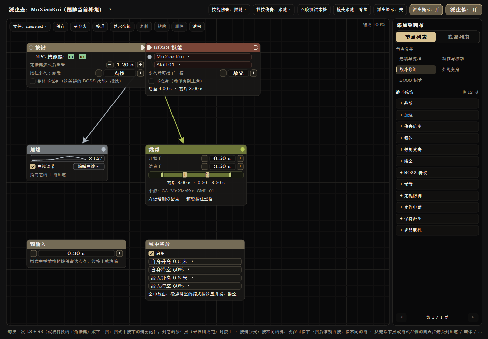

示例从 NPC 技能键连接 BOSS 技能，再分别连接裁剪与加速修饰。下方的预输入、空中释放是当前派生表的固定设置。右侧“节点列表”内按类型分类；页底按钮翻页。

本手册全部界面图由当前版本的真实自绘控件离线渲染，使用隔离的示例数据；没有启动游戏，也不是游戏实机画面。图中招式名、角色状态和时长用于说明操作，以实际游戏读取为准。

## 界面图解：武器列表

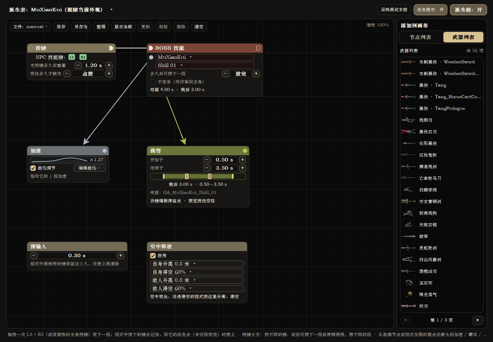

## 界面图解：招式来源

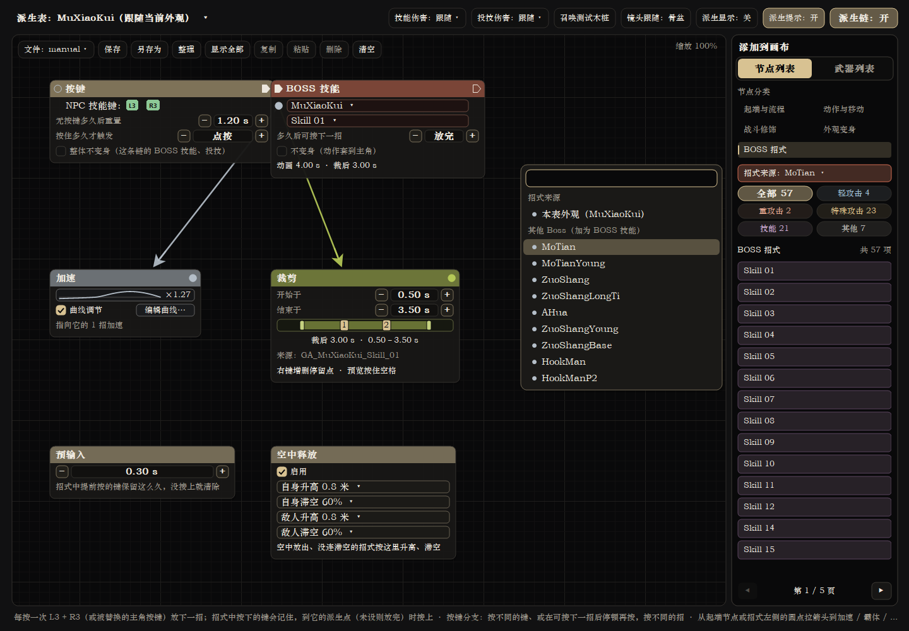

节点列表的「BOSS 招式」分类顶部有「招式来源」下拉框，默认「本表外观」：列出这张派生表所属外观的招式，点一下或拖到画布，就是「当前外观招式」节点。改选另一个 Boss 后，列表换成那个 Boss 的技能（按类型分页同前）；点一下或拖进来，得到的是选好 Boss 和招式的「BOSS 技能」节点。所以主角表或任何 Boss 的表都能直接从列表加入别的 Boss 的技能，不用先加空的 BOSS 技能再挑。下拉框可以输入文字筛选；选择会一直保留，切换派生表也不变，选回「本表外观」即恢复。鼠标停在列表里的招式上会预览那个 Boss 的动作。

“节点列表”和“武器列表”是两个顶级分页。武器列表选择具体武器及动作后添加节点；修改长按、格挡组合等路由，使用“武器派生修改”节点。

## 界面图解：搜索与替换按键

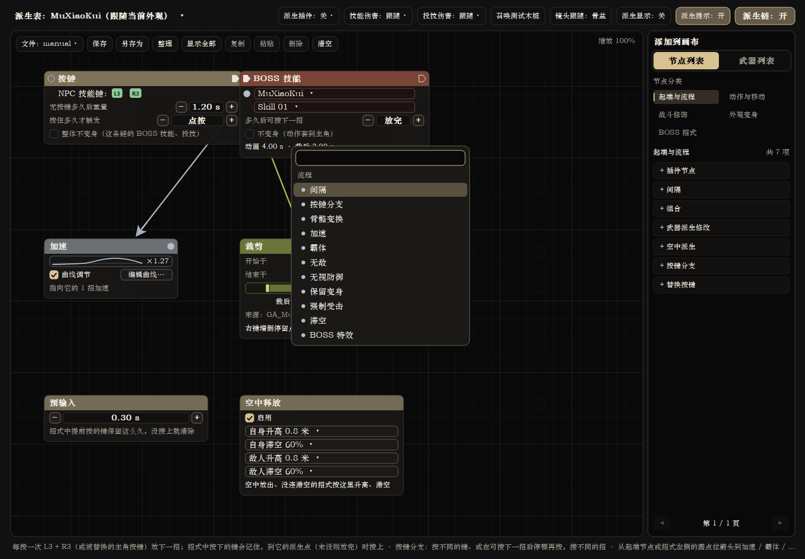

画布右键打开搜索，输入关键词后选择节点。搜索只负责添加；修改已有节点的动作，使用节点上的动作选择框。

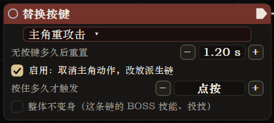

## 界面图解：加速曲线

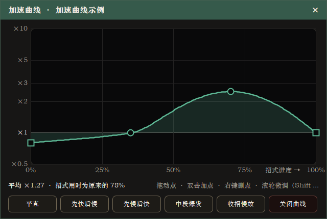

横轴是技能播放进度，纵轴是速度倍率。拖动控制点修改曲线，双击加点，右键删点；滚轮微调，Shift 配合细调。节点中的迷你曲线显示同一组数据。

裁剪节点按原始技能时间指定起止点，裁剪后的播放继续受加速曲线影响；按住停留期间则等待松键。详见裁剪节点章节。

## 界面图解：体型滑条

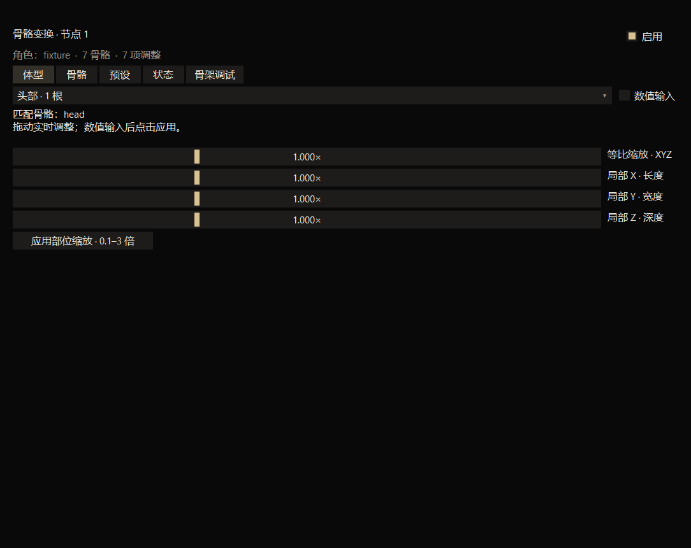

先选择要调整的身体分组，再拖动对应滑条。整体缩放与 X / Y / Z 分轴缩放可配合使用；需要精确数值时启用数值输入。拖动时预览，释放时保存。

普通骨骼按角色原有骨架调整。胸臀额外骨骼需要安装 PBZSoftBones 并启用补充；女性化头部包已移除，与此补充包无关。

## 界面图解：多骨骼编辑

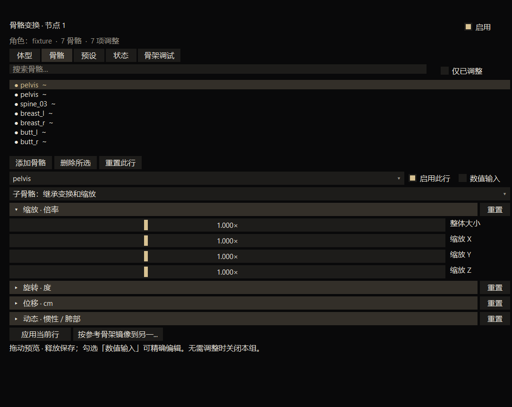

一个骨骼变换节点可包含多根骨骼。上方选中条目，下方编辑缩放、旋转、位移、动态参数；每组可以单独重置，镜像按钮复制到对侧骨骼。图中的 fixture 是离线示例骨架。

“预设”页载入女性动画与动态预设；“状态”页查看生效或缺失项；“骨架调试”页查看完整骨架。节点与全局页共用这套编辑控件，但保存作用域不同。

## 节点 01：按键与替换按键
<!-- node: Trigger -->

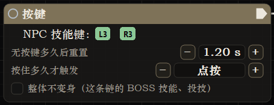

### 用途与入口

「按键」代表 NPC 技能快捷键，是每张表的固定入口。「替换按键」接管指定主角动作：轻/重攻击、影之武装、特殊攻击、战技、格挡、跳跃、不同闪避、处决与简易处决；触发后运行所连派生。

### 接线与参数

没有执行输入，由右侧输出接第一招。可启停、设置重置等待 0.1-5 秒、按住 0-5 秒；0 表示点按。支持“继续派生”另选后续输入。处决可限制武器；“处决”可兼容简易处决，具体行优先。

最后一行「整体不变身」：勾上后，从这个起端开始的链里所有 BOSS 技能和投技（包括组合框里的）都不换外观，等同于逐个勾上它们的「不变身」。只作用于从这个起端开始的链；别的起端连到同一招时按那个起端的设置。

@flow 替换按键：重攻击 > BOSS 技能 > 武器派生

### 运行规则

只设置长按时，未达到阈值的点按仍可交给游戏。点按和长按共享输入时，达到最长阈值可立即触发；提前松开按已达到的最长档判断。切表、换武器或访问变化会撤销旧等待。

起端可指向链级修饰，但裁剪只接 BOSS 技能。原生闪避等动作在允许交接后不会仅因外观恢复就强行取消；是否保持后续位置，另由保持派生和等待状态决定。

### 常见问题

链不启动先检查启用状态和当前表。起端不作为其他节点的执行目标；要显式回环，应连接动作/流程。按键节点、预输入和空中释放各有唯一性规则，粘贴时可能跳过。

## 输入变体：自定义组合键与自定义按键

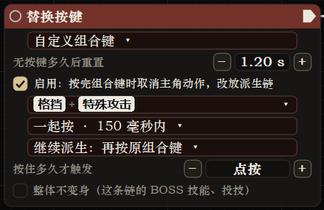

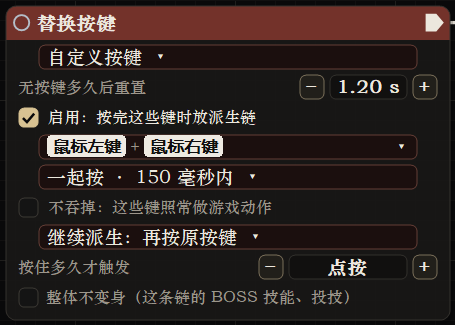

两者属于「替换按键」的输入模式，也可出现在按键分支、武器派生修改的行内，并不是额外的底层节点类型。

### 自定义组合键

按游戏动作选择 2-6 项，例如格挡和当前 E 对应动作。跟随游戏改键和设备映射；可同时按，也可按顺序。顺序输入的相邻键时间窗口为 100-2000 毫秒。不要把“E”固定等同于某项游戏动作。

### 自定义按键

录制 1-6 个实际键盘、鼠标或手柄输入，包括鼠标左/右/中/侧键 1/侧键 2。手柄还可使用左摇杆上下左右方向。录制后 Enter 确认一次、Esc 取消；关闭页面也不会提交草稿。实际按键模式不自动跟随游戏改键。录制的按键包含 NPC 技能快捷键的全部按键时（例如手柄 R3 → L3，而 NPC 技能键是 L3 + R3），按这组键会同时触发 NPC 技能键；派生链在这一步不接 NPC 技能键时，这一下算作这组按键的一部分，不放 NPC 技能，也不中断派生链。

### 同时按、顺序按与吞键

普通组合按当前节点的同时/顺序规则识别；武器行支持保持格挡再按另一成员，只在新的按下沿触发，持续按住不会每帧重放。按住阈值同样可用于组合。自定义按键可选择是否吞掉原动作。「吞掉」只管开始一条新的派生链时第一个键的游戏动作；派生链进行中，按下这组按键里的键时，派生链不接的游戏动作（例如鼠标左键带出的轻攻击）一律算作这组按键的一部分：不放出来，不切断正在放的招式，也不丢掉已记住的下一招。

### 配置示例

用武器派生修改选择目标武器，添加一行自定义组合键「格挡 + 特殊攻击」，连接 BOSS 技能。若要固定物理 E 键而不跟随改键，则使用自定义按键并录入真实按键。先取消无关重复行，避免多个入口争抢同一输入。

## 节点 02：武器派生修改
<!-- node: WeaponActions -->

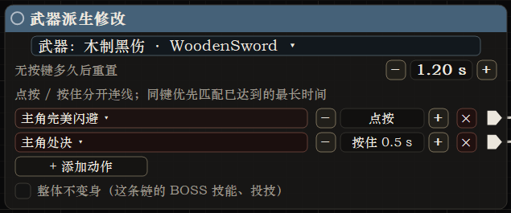

### 用途与接线

只在当前主武器匹配时，将指定动作改为自定义派生。它是多出口起端，每行独立连第一招，没有执行输入；全节点可指向链级修饰。与「武器派生」的区别：这里改输入路由，不直接借武器播放动作。

### 参数

先选精确武器 ID，再设置最多 6 行。每行选择动作、点按/按住时间、自定义组合或按键，并连接出口。提供完美闪避、处决、简易处决、格挡等特殊动作，也可选轻重攻击、跳跃和其他闪避。长按范围 0-5 秒。「+ 添加动作」下面的「整体不变身」与按键节点相同，作用于这个节点所有行开始的链。

### 特殊路由优先级

本节点优先于同动作的普通替换按键。具体闪避优先于任意闪避；有独立简易处决行时走该行，否则处决可接住它。未连接、输入无效或武器不符的行不生效。等待长按时切换武器会撤销等待。

### 示例与排错

同一武器配置两行重攻击：0 秒接招式 A，0.5 秒接招式 B；另加格挡组合接反击招式。最多 6 行，不需要的默认行可删除。同名武器保留不同 ID，选错同名版本也可能导致不触发。

## 节点变体：空中派生

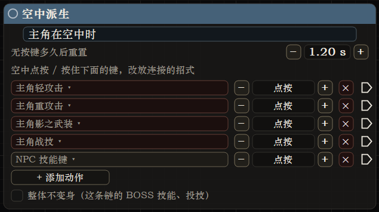

### 用途

空中派生是武器派生修改的空中模式，不绑定武器。只有角色在空中、这次输入要启动新链时，它的行才作为空中专用入口；已经运行的链仍按自己的连线继续。

### 接线与参数

各行独立输出，选择 NPC 技能键或主角动作，支持点按、按住与自定义输入。处决不作为空中入口。重置等待与多出口结构和武器派生修改一致。

@flow 空中派生：轻攻击 > BOSS 技能 A > 武器派生 B

再让 A 指向滞空节点，可设置起手抛起和重力削减。没有局部滞空时，空中施放的合适动作可使用本表「空中释放」默认值。

### 与其他功能的关系

空中派生决定“空中按键走哪条链”；空中释放提供默认运动参数；滞空修饰一招或整链；空中技能 / JC 页面控制原生能力的空中限制与跳跃行为。四者用途不同。

### 常见问题

角色虽然动画腾空，但 Actor 的实际空中状态未改变时，不一定进入空中入口。先核对状态。不要用持续按键期待每帧重触发；按住阈值按当前访问识别一次。

## 节点 03：按键分支
<!-- node: Branch -->

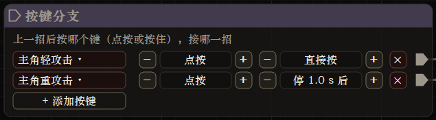

### 用途与接线

在同一段连招后，根据下一次输入与停顿选择不同出口。执行输入接前一招，每行输出接对应后续；支持主角动作、NPC 技能键、自定义组合键和自定义按键。

### 参数与计时

最多 6 行。每行有按键、停顿 0-10 秒、按住 0-5 秒及相应组合输入参数。停顿从执行流到达分支开始，不从整条链最初按键计算；回环重新进入时重新计时。

### 示例

轻攻击 A 后接分支：轻攻击行接 B，重攻击行接 C，另设停顿 2 秒的轻攻击行接 D。输入提前到达而等待条件尚未满足时，按当前节点等待规则保存；不是持续按住就不断重复触发。

### 使用建议

先用不同按键确认各出口，再添加同键不同停顿/长按。注意同一输入多行的优先选择会影响结果。未接出口不会凭空生成下一招，分支本身也不是会播放动画的动作。

## 节点 04：间隔
<!-- node: Interval -->

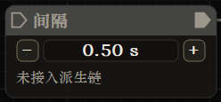

### 用途与接线

在执行路径中加入明确等待：前一招输出接间隔，间隔再接后续动作或分支。它不是修饰节点，没有自己的攻击动画。

@flow 技能 A > 间隔 0.5 秒 > 技能 B

### 参数与时序

范围 0.05-10 秒，默认 0.5 秒。前一招到派生点或自然结束、路径真正进入间隔后才开始计时；每次访问重新计时。已到达的等待不会沿用以前那次访问的时钟。

### 当前行为

间隔不再从上一招开始计时，也不会为了填满间隔而主动慢放前一招。需要慢放请用加速节点的低倍率或曲线。等待结束后仍由当前执行/输入规则决定何时放后续招式，不要把它当作独立自动循环器。

### 常见问题

想在一键组合中调整节奏，把间隔放在组合内部动作之间。若放在需要再按键的普通链上，仍需按后续输入；只有计时结束不会替你凭空按键。

## 节点 05：组合
<!-- node: Group -->

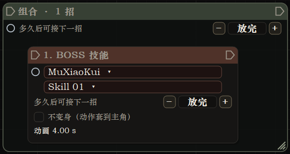

### 用途

用一个框组织多个动作和流程，作为一次输入的一段连招。组合包含的动作沿内部连接运行，便于一键连续施放；可设组合的派生点，并给组合指向适用修饰。

### 接线与编辑

将动作放入组合框并整理内部执行路径，外部接入组合，完成后从组合输出继续。组合最多嵌套 4 层。框大小可调整；复制组合时包含子节点及内部关系，外部引用断开。

### 时序

内部每个步骤有自己的运行与等待状态。某一步允许中断，不等于后面所有步骤自动继承该步的中断权限。组合尚未放完时，不能因为外部再次按起端就跳过链尾完成条件。

### 示例与限制

一次输入启动「BOSS 技能 A → 间隔 → 武器派生 B」。给组合接加速可作用于适用子招式；投技仍遵循成对动作的特殊规则，不因组合派生点就任意剪断。需要切投技时使用允许中断。

## 节点 06：预输入
<!-- node: PreInput -->

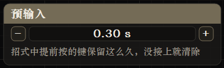

### 用途

每张派生表的固定设置节点，控制动作尚不能接下一招时，提前按下的键保留多久。没有执行或修饰连线，不能重复添加为普通节点。

### 参数

0-5 秒，默认 0.3 秒；0 表示保留到能接上。通常只保存一个待处理输入，新输入覆盖旧输入。过期输入在执行前检查，不因为反复按键就绕过当前招式完成条件。

### 与等待节点的关系

所有连法都从按下计时（招式加载期间按下的从招式开始算），派生点之前超过时长就清除，后面接不接间隔或停顿分支都一样。到派生点时仍在时长内的输入，会等间隔和分支停顿走完再接，这段等待不消耗预输入；能接上后仍被投技等挡住时，最多再保留同样时长。

### 示例

招式 A 剩余约 0.2 秒时提前按下一招，0.3 秒窗口通常能接住；太早按且已超过寿命就需要重按。设为 0 适合调试，但可能更容易在较晚时候释放你先前缓存的输入。

## 节点 07：空中释放
<!-- node: AirDefault -->

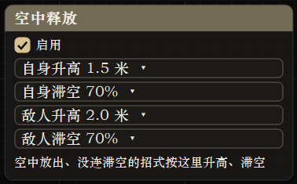

### 用途

每张表固定的空中默认运动设置，没有连线。只有符合条件的动作在空中施放、并且本招/组合/起端都没有指定滞空时，才采用此节点。

### 参数

可启停；分别设置主角和受击敌人的升高 0-1000 cm、滞空 0-100%。默认主角/敌人升高 80 cm、滞空 60%。滞空百分比表示削减重力比例，100% 近似悬停。

### 作用对象

适用于主角实际施放的普通技能、BOSS 技能、武器派生和按方向闪避；钩子、瞬移、投技、援护及纯外观切换走各自机制，不套用这组空中运动。

### 示例与排错

空中按轻攻击进入空中派生，播放 BOSS 技能；没有连接滞空时使用本节点。若局部已连滞空，修改此节点看不到效果是正常的优先级结果。关闭它只关闭额外升高/滞空，不代表禁用所有空中技能。

## 节点 08：当前外观招式
<!-- node: Skill -->

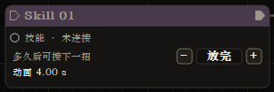

### 用途

播放当前派生表所属 NPC 外观的一个原生招式。列表按轻攻击、重攻击、闪避、闪避攻击、特殊攻击、技能、绝技、连招、其他分类；实际节点标题可能直接显示招式名。

### 接线与参数

接在起端、分支或其他动作后，执行输出接下一招。可设置派生点 0-10 秒；0 等结束。可指向加速、伤害倍率、霸体、无敌、无视防御、允许中断、保持派生、强制受击、滞空、骨骼变换等适用修饰。

### 与 BOSS 技能的区别

本节点依赖当前表/外观，不额外选择另一个 Boss；「BOSS 技能」同时指定 Boss 与招式，并可跨外观自动切换。本节点和 BOSS 技能均可直接连接裁剪节点。

### 示例与限制

在沐小葵表中选择一个轻攻击接后续技能，切换到该外观后测试。单个招式可能依赖特定武器、目标或原 Boss 蓝图状态；名称存在不等于已保证完整伤害和特效。

## 节点 09：BOSS 技能
<!-- node: BossSkill -->

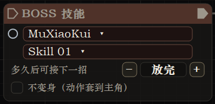

### 用途与接线

先选 Boss 外观，再选招式，执行到这里时按需要切换外观并播放。前后接执行线；修饰圆点连接单招参数。支持不变身、派生点和技能预览。

### 外观与武器

默认瞬身变为所属 Boss。连续链可保持当前变身到下一动作，再切到其他 Boss 或回主角；链结束/中断/超时按当前外观保持规则处理。不变身时保留当前身体，借用这招的武器和适配动作。起端设了「整体不变身」时，这条链里的这一招也不变身；卡片上的不变身行会显示「起端已设整体不变身」，此时指向它的保留变身不起作用。

### 修饰

支持常规战斗修饰、滞空、骨骼变换、保留变身；它是裁剪节点唯一的直接来源类型。可以同时连接裁剪与加速，速度曲线按当前招式进度作用。

@flow 替换按键 > BOSS 技能 > 下一招

另从该技能分别指向裁剪、加速或骨骼变换。主角能放动作但看不到部分特效时，应区别显示、武器与伤害适配问题，不能仅靠提高伤害倍率补出缺失资源。

## 节点 10：武器派生
<!-- node: WeaponMove -->

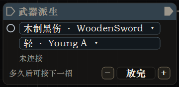

### 用途

临时换上指定主角武器并播放其一个原生招式，结束后恢复武器。它是执行动作，不是按武器筛选输入的起端。

### 参数与接线

选择精确武器和招式，接入执行链；可设派生点并连接常规适用修饰、滞空或骨骼变换。武器可由右侧武器列表选择、拖到画布或已有节点。

### 长按与特殊派生

带 B_Hold / BCharge 等原生技能名的条目有长按/蓄力标识，用来区分蓄力起手、攻击与松开等资源。选择这些技能不等于自动把原生蓄力所有阶段合成一招。希望输入按住后选择不同动作，应在起端或武器派生修改设置长按行。

### 示例与限制

BOSS 技能之后接某把长刀的原生派生；当前是 NPC 外观时，可以保持外观播放主角武器动作。相同显示名的不同武器 ID 保留独立条目，技能集合可能不同。缺少必要原生状态的技能需要实机检查。

## 节点 11：按摇杆方向闪避
<!-- node: AutoDodge -->

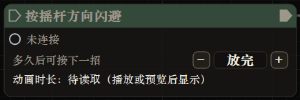

### 用途

用当前外观自己的闪避招式，按摇杆方向选择前后左右；无方向时使用回退方向。适用于拥有独立闪避目录的 Boss 外观，不是通用主角闪避复制。

### 接线与参数

作为动作接入执行链，设派生点并连接加速、战斗修饰、滞空或骨骼变换。来源是当前外观的闪避表，不在节点内任意选择另一个 Boss。

### 示例

轻攻击 A 后接按方向闪避，再接反击 B。下一次推进时按摇杆方向决定闪避。若要任意时刻用原生主角闪避退出当前招式，使用允许中断；若要闪避后回来继续，则配合保持派生。

### 常见问题

没有闪避目录的外观会提示“这个外观没有闪避”。节点存在不保证当前角色具备四向完整动作。方向选择与输入路由分别配置，先确认到底触发了哪个入口。

## 节点 12：投技
<!-- node: Grab -->

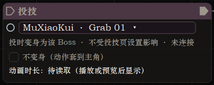

### 用途与参数

在节点中选择任意支持的 Boss 投技，可选不变身；不依赖投技页当前选择。默认使用所属 Boss 外观和武器，按原生规则隐藏需要隐藏的武器。附近没有有效可投目标时可跳过此动作。

### 接线限制

它是执行动作，但直接修饰只接受「允许中断」。不接受加速、裁剪、骨骼变换等普通单招修饰。起端/组合的中断规则可影响它，组合派生点本身不等于允许切断成对动作。

### 播放与中断

默认完整播放配对动作，避免丢失收尾伤害。允许中断时主角可接下一招；满足条件的 NPC 身体副本可留在原处完成投技，目标仍留在被投动作中。上一投技尚未收尾时，下一个投技会等待清理。

### 示例与排错

技能 A 后接投技，再接技能 B。先不加中断测试完整伤害，再加入允许中断测试交接。目标状态不允许被投、没有目标或缺配对资源，都可能使它不成立；不能用无视防御保证所有目标可投。

## 节点 13：BOSS 援护
<!-- node: Assist -->

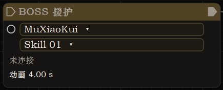

### 用途

召来一个独立 Boss 放指定招式，主角不变身。援护出现在锁定目标附近；没有锁定时尝试找附近敌人，施放后离场。与主角同阵营的召唤机制用于攻击敌人。

### 接线与输入

选择 Boss 和招式，串在执行路径中。同一次按键可以穿过援护继续放后面的主角动作；它不是必须占满主角整次施放的普通变身招。

### 修饰规则

支持加速、伤害倍率、强制受击、无视防御、霸体、无敌、允许中断、保持派生等适用修饰；效果作用到援护 Boss 及其施放。起端武器属性可影响伤害。裁剪、保留变身和主角滞空不适用。

### 并发与限制

没有允许中断时最多三个援护同时在场；允许中断可令同节点再次调用顶替旧援护。Boss 的特殊蓝图依赖、子弹和特效需要按招检查。援护是本地战斗召唤，不是联机替身。

## 节点 14：瞬移
<!-- node: Teleport -->

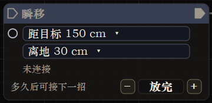

### 用途

瞬身到锁定目标面前；未锁定时尝试使用附近敌人。它改变角色位置，不只是移动镜头或模型。

### 参数与接线

接入执行链，设置距离目标 50-1000 cm，离地高度 0-300 cm。默认约 150 cm 距离、30 cm 抬高。按节点界面可用项设置派生点或适用修饰。

@flow 按键 > 瞬移 > BOSS 技能

### 使用建议

距离按胶囊/角色空间计算，不是武器尖端到敌人的精确距离。先用较保守距离和地面目标测试，再调近身连段。没有目标、目标失效或位置不可用时，不应期待节点任意传送到屏幕准星。

### 与钩子的区别

瞬移偏向立即接近目标；钩子按瞄准方向使用锁镰拉人或飞行，并可指向地面/墙面。不要给两者叠加主角滞空来推断统一运动效果，它们各自管理移动。

## 节点 15：钩子
<!-- node: Hook -->

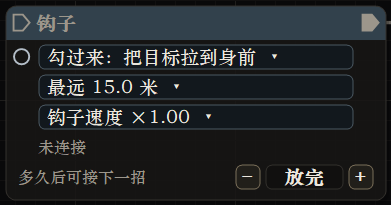

### 用途

使用主角追命锁镰的原生动作。勾过来将目标拉向主角；勾过去使主角飞向目标；自动模式根据目标破防状态决定拉人还是飞过去。

### 瞄准与参数

优先锁定目标，其次准星下敌人，再考虑地面或墙面；指向地形时按飞过去处理。距离范围 300-3000 cm，默认 1500；速度 50-300%，默认 100%。速度影响钩子与拉动过程，也可与加速配合。

### 接线与示例

钩子是动作节点，临时持有锁镰，前后接执行线；可设派生点与普通适用修饰。用「钩子：自动 → 近战技能」制作接近/拉回连段。

### 限制

不接受主角滞空修饰，避免与自身位移机制冲突。地形遮挡、可瞄准距离、敌人状态和钩子原生规则会影响结果。当前版本以节点方式保存，不需要把主角永久装备改成锁镰。

## 节点 16：变身
<!-- node: Look -->

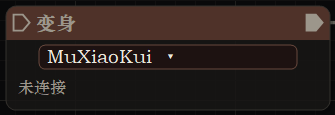

### 用途

直接切换到指定 NPC/Boss 外观，并在派生链结束后继续保留。与 BOSS 技能临时变身不同，它本身就是持久外观切换动作。

### 接线与参数

选择外观，接在执行路径上。按一次推进触发一次切换；没有选择外观时不会生成有效动作。纯外观切换不接受普通战斗修饰箭头。

@flow 按键 > 变身：指定 Boss > 后续动作

### 后续行为

后续运行与编辑表需要注意当前外观。若只是希望某个技能播完后保留它的 Boss 外观，应将该 BOSS 技能指向保留变身，而不是混淆成单独的变身节点。

### 常见问题

本次列表不含女性化主角，也不含旧剑心外观。保存文件里可能有历史表名，但不能据此生成已移除的外观或资源。临时装配、切场景和资源异常以状态区/日志为准。

## 节点 17：变回主角
<!-- node: HeroLook -->

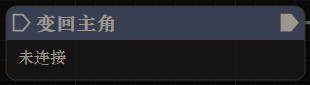

### 用途

从当前 NPC/Boss 外观主动恢复主角。作为明确的执行动作使用，链结束后保持主角外观。

### 接线

从起端或上一个动作接入，输出接后续动作。不需要选择 Boss，也不接受普通战斗修饰。与临时 BOSS 技能自然结束后的自动恢复不同，这里在指定路径上明确安排恢复时机。

@flow BOSS 技能 > 变回主角 > 武器派生

### 使用建议

跨外观连招先确认每段期望的身体和武器，再决定哪里变回。武器派生本身可在 NPC 外观下执行，并不一定要求先放这个节点；只有希望外观回主角时才使用。

### 排错

若当前招式仍在受中断权限保护，不能靠再按入口强行绕过动作完成门槛。投技还在成对收尾时也会有清理等待，外观恢复与技能收尾不是同一件事。

## 节点 18：加速
<!-- node: Speed -->

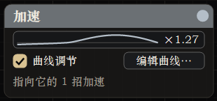

### 用途与接线

从起端、适用动作或组合的修饰圆点指向加速。起端影响整链，动作影响这一招，局部优先。一个加速节点可被多个来源共用，不串入执行路径；投技不直接接受。

### 参数与曲线

固定倍率 0.5-10 倍；小于 1 即慢放。开启曲线后使用动作进度 0-100% 对应的速度，最多 16 个控制点；支持拖点、双击加点、右键删点、滚轮微调及预设。曲线编辑窗显示实际倍率范围。

### 实际影响

通过角色时间缩放影响动画、技能时间轴、移动及武器，并与原生命中停顿共同作用。结束后移除本功能的缩放。预览接收相同参数，裁剪仍按原动画时间定位。

### 示例与误区

让起手 0-30% 为 0.8 倍，中段 2 倍，收尾恢复 1 倍。给单招和起端各接一个加速不表示二者简单相乘。不要用加速替代间隔；间隔是到达后的等待。

## 节点 19：裁剪与按住停留
<!-- node: Trim -->

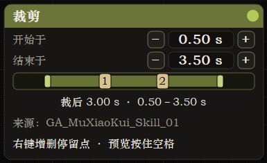

### 接线

接受当前角色招式、BOSS 技能、武器派生和方向闪避直接指向；不接起端、组合、投技、援护或钩子。一个裁剪可被多个技能共用，各自使用实际动作的原始时长。技能和动画节点底部显示原始动画长度，连接裁剪后显示裁后长度；未知长度等待播放或预览读取。方向闪避及自动钩子显示最近一次动作的长度，投技通过执行者动画预览读取。这里的秒数是动画时间，不包含按住等待，也不等同于加速后的现实耗时。

### 起止与时长

起止范围 0-60 秒，步进 50 毫秒。结束为 0 或不晚于开始时按原动作末尾处理。时间轴两端可拖动，结束数值支持滚轮，拖动会更新预览。节点显示有效裁后动画时长、起止与来源；未读到原长时明确等待，不伪造总时长。

### 多个按住停留点

时间轴右键添加/删除停留点，左键拖动编号点，最多 32 个。播放到点且本次触发键仍按住时暂停；松开继续。预览用空格按住。裁剪范围外的点不触发；未按住则直接通过。

### 加速与镜头

裁剪和停留跟随动画时间，固定倍率与速度曲线仍生效。跳转前保存身体基准，跳转后按身体实际位移补偿镜头；真实障碍可限制跟随，不能用无障碍公式保证所有场景构图。

### 示例

1.8-4.1 秒裁出 2.3 秒动作，在 2.5 和 3.3 秒设停留点。按住经过两点可分别停住，释放才继续；两倍速只缩短实际播放部分，不缩短你人为按住的时间。

## 节点 20：骨骼变换
<!-- node: BoneTransform -->

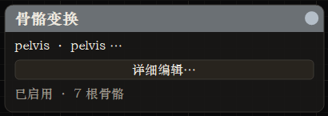

### 接线与作用域

与加速同类修饰连接：由起端、适用动作或组合指向，不能放在执行线中。投技和纯外观切换不接受直接连接。节点启用时优先于全局骨骼配置，未匹配骨骼会跳过。

### 多骨骼编辑

一个节点最多 32 行。卡片显示前两根骨骼与总数量，打开详细页编辑位移、旋转、缩放、动态模式、强度、位移上限、频率和阻尼。可添加多行、启停、删除、重置、镜像，或载入女性动作预设。

### 预览与保存

详细页与独立骨骼页共用自绘滑条。拖动即时预览，松手提交，数值输入用于精调。预览按预览角色自己的骨架匹配，不按主角的骨骼数量硬套。

### 示例与限制

给某招连接骨骼节点，缩放手臂并为胸臀设置惯性跟随。缺少胸臀骨骼时，需要兼容 PBZSoftBones 和全局补充开关；该开关不写进节点。身体变形不自动制作服装权重，碰撞是骨骼/近似盒体级，不是逐顶点模拟。

## 节点 21：伤害倍率
<!-- node: Damage -->

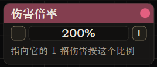

### 用途与接线

调整作用范围内招式的伤害份额。起端指向则整链生效，动作或组合指向则缩小范围；多个来源可共享一个倍率节点。

### 参数

0-10 倍，新节点通常为 2 倍；0 可用于无伤害演出测试。它与 NPC 页总体伤害配置、武器属性等是不同来源，检查效果时先明确启用了哪些层。

### 示例

连段普通攻击保持 1 倍，只给收尾技能接 2 倍伤害。给援护连接时由援护施放应用对应修饰。投技不接受这个节点直接修饰，投技页另有自己的伤害配置。

### 限制

该节点调整已成立的伤害，不创建缺失的攻击碰撞、弹丸或时间轴。某招完全没有命中时，增大倍率不等于修复该招；先确认目标、武器和判定。

## 节点 22：武器属性
<!-- node: Weapon -->

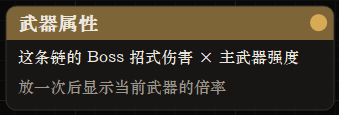

### 用途

将主角主武器强度倍率用于这条链的 BOSS 招式伤害（变身与不变身施放都算），便于使派生随装备成长。武器派生、钩子、瞬移和主角自己的技能本来就按主角武器算伤害，不会再乘一次。不是更换武器模型，也不是编辑武器的全部原生属性。

### 接线限制

只接受起端指向，不直接接普通动作、组合或投技。起端包括普通按键/替换按键与武器派生修改等多出口入口。它是链级修饰，不占一次按键。

### 示例

替换重攻击起端指向武器属性，再连 BOSS 技能。切换主武器后观察同样目标上的伤害变化，避免同时改 NPC 总倍率和伤害倍率节点造成难以判断的叠加。

### 常见混淆

想临时用另一把武器放招，请用武器派生；想拿某把武器时改变格挡/长按输入，请用武器派生修改。三者名称接近，功能分别是伤害属性、播放动作、输入路由。

## 节点 23：霸体
<!-- node: Armor -->

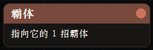

### 用途与接线

让适用招式播放期间受击不轻易打断。由起端、动作或组合指向，在当前施放角色上维护相应状态；援护的修饰作用到援护自身。

### 生效与清理

包括技能启动和变身过渡期间需要的状态维护；原生流程摘除时可按租约补回，施放结束清理本功能拥有的状态。切换角色时重新绑定，避免旧节点等待误作用到新演员。

### 示例

给长前摇 BOSS 技能单独接霸体，其他快速招式不接。再根据需要连接伤害倍率，但不要因为有霸体就认为不会掉血。

### 与无敌的区别

霸体解决受击动作中断，仍可能受到伤害；无敌用于不被击中。投技不直接接受霸体修饰，其配对状态由原生投技系统处理。

## 节点 24：无敌
<!-- node: Invincible -->

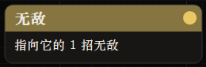

### 用途

在适用招式播放期间维护原生无敌标签，防止被命中。由起端、动作或组合修饰箭头连接；援护则作用到援护演员。

### 时序

随着本次施放启动并在结束/切走时清理，只移除本功能持有的状态。它不是永久角色属性，不能指望断开的无敌节点仍保护角色。

### 示例

给一个用于演示的大动作接无敌，确认动作与镜头后移除。局部修饰适合控制保护范围，避免整链都无敌而无法评估动作风险。

### 原生反馈

敌人的 AI 可能像面对原生闪避无敌一样改变攻击行为或暂缓攻击，这属于原生状态反馈。无敌与霸体、不会死亡等调试选项不是同一机制；也不代表解除剧情/地图强制状态。

## 节点 25：无视防御
<!-- node: IgnoreGuard -->

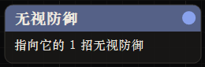

### 用途与连接

在适用招式期间给附近敌人维护原生“不能弹反”状态，帮助攻击越过格挡/弹反。由起端、动作或组合指向；援护以自身周围敌人为范围。

### 范围与清理

主角施放时使用附近约 60 米范围内的敌人，结束时只撤销本功能添加的状态，不覆盖其他系统原有状态。

### 示例

某段收尾技能希望强制打入敌人防御，则只给该招接无视防御。要更改命中后的反应，另接强制受击；要增大伤害，另接伤害倍率。

### 限制

不是万能破盾，也不是无视一切无敌。已举起的独立盾牌或其他原生硬条件可能仍存在。它不使没有攻击判定的动作自动造成伤害。

## 节点 26：强制受击
<!-- node: ForceHit -->

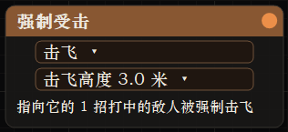

### 用途

命中时令敌人采用选择的原生受击反应，用来组织击飞、击倒、挑空、击退、破防或硬直等演出。可穿过部分霸体反应限制，但前提仍是这次攻击命中。

### 参数与连接

由起端、适用动作或组合指向，选择界面提供的反应种类。带抛起高度的模式可调 0-1500 cm；默认高度约 300 cm。与滞空共同使用时取相应较高的抛起需求，不把同一招每次命中重复抛起。

### 示例

起手技能接挑空/击飞反应，再接滞空与后续空中动作。先用测试木桩确认命中时机，再用真实敌人观察原生反应与状态限制。

### 误区

强制受击不等于提高伤害；无伤害测试也可单独观察反应。目标特殊体型、剧情状态或原生配对动作可能有独立限制，不能假设所有 Boss 都有同样的倒地动作。

## 节点 27：允许中断
<!-- node: Interrupt -->

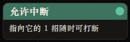

### 用途

放宽当前动作的切换权限，使下一次可接的输入立即推进；无法接入的原生闪避、跳跃等也可结束当前动作。由起端、动作或组合指向。

### 与派生点的区别

派生点规定从某个时间开始才允许衔接；允许中断是主动放宽中断门槛。它不应被误用来替代链尾完成规则。没有权限的输入会被忽略或按预输入等待，而不是无条件切招。

### 投技与援护

这是投技唯一接受的直接修饰。中断配对投技可能留下本体完成演出，主角接下一动作；后续投技仍可能等待旧投技清理。援护有此修饰时同节点重召可替换仍在施放的旧援护。

### 示例与代价

给长收尾技能接允许中断以便闪避退出。中途切掉可能失去尚未发生的伤害或特效；想保留连招位置需结合保持派生，不应默认所有中断都保留链。

## 节点 28：保持派生
<!-- node: KeepChain -->

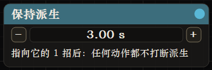

### 用途与接线

允许在连招中穿插闪避、移动或接不上的原生动作后，仍从当前派生位置继续。起端指向影响整链，动作或组合指向影响对应段落。

### 参数与时序

等待范围 0.5-30 秒，默认 3 秒。招式结束或最近一次允许穿插的动作后重新计算等待，超时才回到首招；不是从第一招开始一直倒数。

### 输入规则

能接上的按键仍遵循当前派生点。无法接上的动作可以切出当前招式并让主角正常行动，旧预输入作废，派生位置保留。它不会为链尾凭空创建下一招，真正没有后续动作时仍正常结束。

### 示例

A → B → C，给 A 接保持派生。放 A 后闪避并移动，等待窗口内按继续输入可接 B。与允许中断、起端重置时间一起调整时，一次只改一个因素，确认行为后再组合。

## 节点 29：保留变身
<!-- node: KeepLook -->

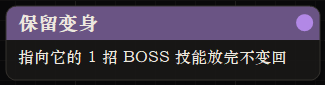

### 用途

让 BOSS 技能使用的外观在动作或整条链结束后继续保留，之后使用该 Boss 对应的派生表。它是外观保持修饰，不负责播放招式。

### 接线限制

只接受 BOSS 技能、起端或组合指向；其他普通动作、投技、援护不能直接使用。起端/组合范围内仅适用的 BOSS 技能产生对应效果。

### 示例

主角表的某个 BOSS 技能指向保留变身，施放后留在该 Boss。之后打开派生页或继续起端输入时，需要理解当前外观已变，不能仍按主角表查找规则。

### 与变身节点的区别

保留变身依附技能；变身节点是一个独立的持久外观切换动作。不要给同一段加互相矛盾的恢复外观流程。需要返回主角时，使用变回主角或 NPC 页恢复。

## 节点 30：滞空
<!-- node: Air -->

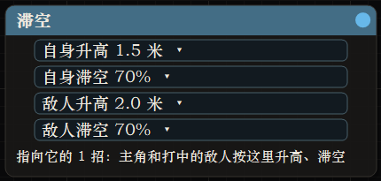

### 用途

在招式开始时把主角抛起并削减重力；命中敌人时也可抛起并保持。每次施放的主角起手抛起只触发一次，受击目标同招也有防重复抛起。

### 参数

主角/敌人分别设置升高 0-1000 cm、滞空 0-100%。新节点默认主角升高 150 cm、敌人 200 cm，双方滞空 70%。100% 表示移除该阶段重力，0 表示不额外削减。

### 接线范围

起端、组合、当前外观技能、BOSS 技能、武器派生、按摇杆方向闪避可指向它。钩子、瞬移、投技、援护和纯外观动作不接此修饰。有局部滞空时覆盖空中释放默认设置。

### 示例与边界

给挑空起手设置较高敌人抛起，后续动作使用较低升高与较高滞空保持连段。可与强制受击组合，但不要假设每次命中都重新加高度。落地、结束和对象变化会走恢复路径；极端高度与地形仍需实机检查。

## 节点 31：BOSS 特效
<!-- node: BossEffect -->

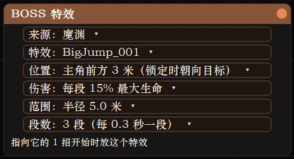

### 用途

招式开始时播放游戏里的一个战斗特效，并可对周围敌人造成伤害。特效来自游戏资源里各 BOSS、敌人以及通用、主角武器的特效目录，不需要额外资源包。

### 参数

依次选择来源目录、特效、位置（武器上、主角脚下、主角前方 3 米、锁定目标身上）、每段伤害（最大生命的 0-100%，0 只放特效）、伤害半径 1-20 米、段数 1-10（每 0.3 秒一段）。新节点默认 10%、4 米、1 段。鼠标停在特效列表的一行或卡片上会在预览卡片里循环播放该特效。

锁定敌人时特效跟着锁定走：「锁定目标身上」放在锁定的敌人脚下，并在特效持续期间一直跟着它（未锁定时放在最近的敌人脚下，不跟随）；「主角前方 3 米」改为朝锁定目标方向的 3 米处；「主角脚下」「主角前方」「锁定目标身上」的特效都朝向锁定目标。「武器上」跟随武器，不受锁定影响。

### 接线范围

起端（整条链每一招）、组合（组合里每一招）和各类招式可以指向它；变身、变回主角不接。特效随这一招持续，招式结束后淡出；本身会结束的特效会提前结束。

### 示例与边界

给一个 BOSS 技能连上另一位 BOSS 的刀光特效、位置选武器上，即可在出招时挂到手中武器。特效原本按 BOSS 的体型和武器制作，换到主角身上大小和朝向可能不完全吻合；需要采样骨骼网格的特效会改为采样手中武器。伤害按范围和段数结算，与特效画面是否真的扫到敌人无关。

## 配方：长按、格挡组合与空连

### 点按与长按两路

武器派生修改中选择实际装备 ID，添加重攻击点按行与重攻击按住 0.5 秒行，分别连 A/B。先测试松开早于阈值走 A、达到阈值走 B，再添加后续链和修饰。

### 格挡 + E

若跟随游戏改键：用自定义组合键，选择格挡和 E 对应游戏动作，同时按。若固定物理按键：用自定义按键录制实际键，Enter 确认。武器行支持先按住格挡再按另一键，持续不重复触发。

### 裁剪蓄力收尾

BOSS 技能指向裁剪，设置起止及一个停留点；再指向加速，使用“慢起手、快收尾”的曲线。测试点按直接通过、按住暂停、松开续播。最后核对裁后的动画时长与实际播放时间的区别。

### 空中持续派生

用空中派生的轻攻击行接 A → B，A/B 按需要连接滞空或使用空中释放默认值；命中反应另由强制受击决定。JC 页用于近敌弹跳与空中普攻限制重置，不必为了空中节点而强制开启全部资源奖励。

### 闪避后续接

给 A 接保持派生，设置 3 秒窗口；如果需要 A 施放中随时闪避，另接允许中断。实测先 A、闪避、再按接 B，避免把不相关输入重复按到隐式链重启。

## 资源、恢复与常见问题

### 可选资源

PBZSoftBones：将同版本 .pak/.utoc/.ucas 放在 version.dll 旁的 PBZSoftBones 目录，使用 r2 或后续匹配版本；骨骼页开启补充。它补胸臀骨骼和蒙皮，不改变主角头部为女性化。当前资源覆盖 69 个不同身体，映射主角及 75 个外观条目。

PBZDebugSupplement：独立原版调试资源，按 PAK_WORKFLOW 指南放入对应 ProjectPBZ/Content/Paks 搜索路径。它与普通技能预览、节点编辑相互独立。主包不包含该调试资源。

女性化主角专用包已退出本版，不应安装 PBZHunFeminine；原始 OBJ 等作者制作文件不是本安装包内容。

### 常见问题速查

| 表现 | 优先检查 |
|---|---|
| F10 没面板 | 是否完整版、DLL 位置、游戏版本和 EnvCheck 报告 |
| sampleCombo 没出现 | 安装器实际输出名称、PBZ.exe 同层 combos、是否解压完整 |
| 节点没触发 | 当前文件/外观表、起端开关、输入和武器 ID、出口是否连接 |
| 停顿反复触发 | 是否真正再次访问节点、重复入口、输入按下沿；核对最新 DLL |
| 镜头没跟上 | 裁剪来源、真实障碍、NPC_VIEW 的目标/发送高度与偏角 |
| 骨骼调节无效 | 组/行启用、真实骨骼匹配、补充包版本、衣物遮挡、动态模式 |
| Jiggle 不明显 | 是否惯性跟随、是否有加速度、强度与位移上限、频率和阻尼 |
| 技能无伤害/特效 | 有效目标、武器和原生判定、技能依赖；倍率不生成缺失效果 |
| 替身不能 PVP | 目前是显示同步与独立实验血量，不是完整原生联机战斗 |

关闭相关功能后再排查；不要通过覆盖自己的 default 来恢复。日志位于 PBZDebugMenu.log，可用 NPC_VIEW、NPC_COMBO、NPC_POOL、NET_ 等前缀定位对应问题。

## 覆盖范围与来源

本手册逐项覆盖当前 NodeType 的 31 种类型，并另解说自定义输入和空中派生变体。BOSS 招式与武器动作属于动态资源条目，使用同一节点类型，不为每个动作另设一章。

功能页面以 src/core/proxy.cpp 注册项为准；节点类型、参数和连线规则以 npc_combo_model.h、combo_menu.cpp 及 npc_retarget.cpp 为准；资源、骨骼与特殊武器输入说明分别对应 SOFT_BONES、ANIMATION_PRESETS、WEAPON_DERIVATIONS 文档。sampleCombo 的数量来自发布文件实际解包与回读。

本版有离线状态测试、保存压力测试和安装校验，但并非全部角色、技能、过场和联网组合都完成实机验收。联机、部分特效与特殊演出按功能页和本文所列范围使用。

骨骼编辑的交互设计参考 XTGMods / UUEPBS。PBZ 实现独立编写，没有分发其代码或二进制；署名与所核查版本的许可证状态见随包 THIRD_PARTY_NOTICES.md 和 licenses/UUEPBS-LICENSE-STATUS.txt，不把 Dear ImGui 的 MIT 许可证当成 UUEPBS 的许可证。

项目与下载：https://github.com/Jersyi/cringe-blade-zero

构建、游戏更新适配及独立 pak 制作方法见仓库 docs/BUILD.md、docs/GAME_UPDATES.md、docs/PAK_WORKFLOW.md。PDF 和 Markdown 为同一份手册内容。
